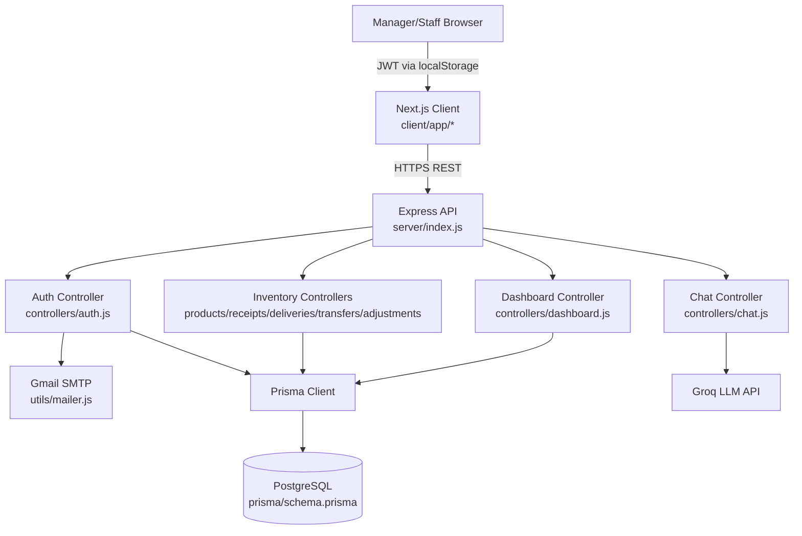
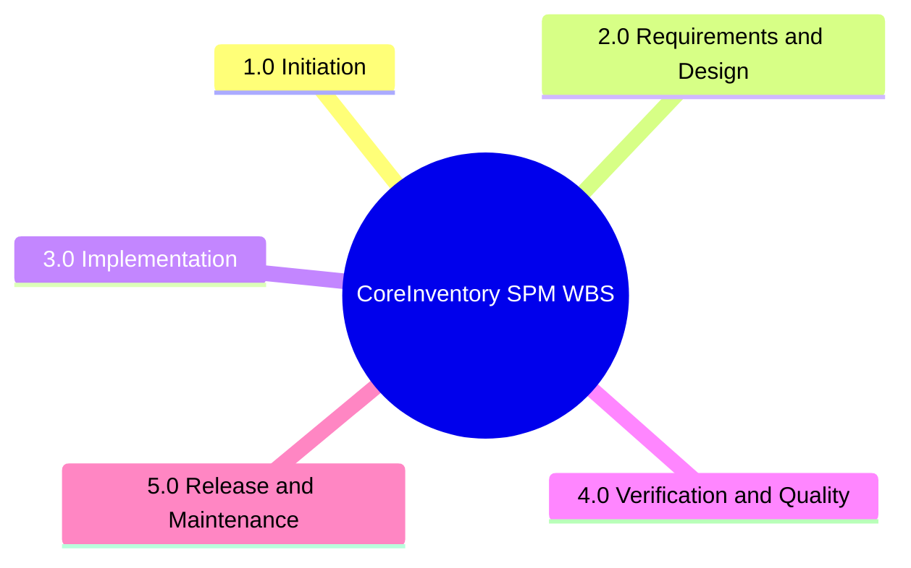
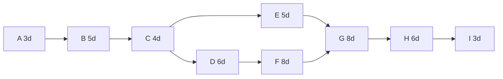
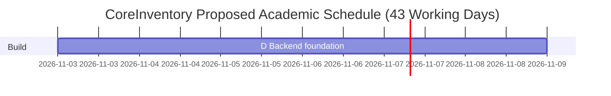

# Software Project Management Report: Tutorials T1–T12

## 1. Cover page

**Title:** Software Project Management Report: Tutorials T1–T12  
**Project:** CoreInventory (repository: `ht1505/odoo-X-indus-26`)  
**Course Context:** Software Project Management (Academic Submission)  
**Prepared for:** Tutorial Tasks T1–T12  
**Prepared by:** Repository analysis based on implemented code artifacts  
**Date:** 2026-10-16

---

## 2. Abstract / Executive Summary

This report applies Software Project Management (SPM) techniques to the CoreInventory full-stack repository. The analysis is grounded in inspected code under `client/` (Next.js/TypeScript UI) and `server/` (Express/Prisma/PostgreSQL API). The system implements OTP-based authentication, stock operations (receipts, deliveries, transfers, adjustments), warehouse and supplier views, dashboard KPIs, and AI-assisted inventory chat.

To maintain academic integrity, each statement is labeled as one of: **[Verified repository fact]**, **[Repository-derived estimate]**, **[Academic assumption]**, or **[Proposed plan]**. Where operational data is unavailable (historical effort/cost/test coverage), transparent assumptions and hypothetical monitoring examples are used.

---

## 3. Table of Contents

- [1. Cover page](#1-cover-page)
- [2. Abstract / Executive Summary](#2-abstract--executive-summary)
- [3. Table of Contents](#3-table-of-contents)
- [4. Project Overview and Repository Analysis](#4-project-overview-and-repository-analysis)
- [5. Assumptions and Estimation Conventions](#5-assumptions-and-estimation-conventions)
- [6. T1 — Introduction to Software Projects](#6-t1--introduction-to-software-projects)
- [7. T2 — Software Development Process Models](#7-t2--software-development-process-models)
- [8. T3 — Project Planning](#8-t3--project-planning)
- [9. T4 — Work Breakdown Structure](#9-t4--work-breakdown-structure)
- [10. T5 — Project Scheduling](#10-t5--project-scheduling)
- [11. T6 — Process and Project Metrics](#11-t6--process-and-project-metrics)
- [12. T7 — Software Effort Estimation](#12-t7--software-effort-estimation)
- [13. T8 — Object-Oriented Estimation](#13-t8--object-oriented-estimation)
- [14. T9 — Risk Management](#14-t9--risk-management)
- [15. T10 — Project Monitoring and Tracking](#15-t10--project-monitoring-and-tracking)
- [16. T11 — Software Project Audit](#16-t11--software-project-audit)
- [17. T12 — Quality Assurance and Quality Control](#17-t12--quality-assurance-and-quality-control)
- [18. Overall Project Assessment and Recommendations](#18-overall-project-assessment-and-recommendations)
- [19. Conclusion](#19-conclusion)
- [20. References](#20-references)
- [21. Appendices](#21-appendices)

---

## 4. Project Overview and Repository Analysis

### 4.1 Repository-grounded summary

- **[Verified repository fact]** Frontend stack: Next.js 14.2.35 + React 18 + TypeScript (`/client/package.json`).
- **[Verified repository fact]** Backend stack: Express 5, Prisma 5, PostgreSQL, JWT, bcryptjs, nodemailer, Groq/Anthropic/Google AI SDK deps (`/server/package.json`).
- **[Verified repository fact]** Product identity: `CoreInventory` (`/client/app/layout.tsx`), landing redirect to login (`/client/app/page.tsx`).
- **[Verified repository fact]** API route mounting for auth/products/receipts/deliveries/transfers/adjustments/ledger/dashboard/categories/suppliers/locations/chat/users/warehouses (`/server/index.js`).
- **[Verified repository fact]** Data model includes User, Warehouse, Location, Category, Supplier, Product, Stock, transaction lines, and StockLedger with operation statuses (`/server/prisma/schema.prisma`).
- **[Verified repository fact]** OTP flows exist for signup and forgot-password, using in-memory store object (`otpStore`) and email sender (`/server/controllers/auth.js`, `/server/utils/mailer.js`).
- **[Verified repository fact]** Build config disables ESLint blocking at build (`/client/next.config.mjs`).
- **[Verified repository fact]** Server test script is placeholder and exits with error (`/server/package.json`).

### 4.2 High-level architecture

See diagram: `reports/spm/diagrams/architecture_data_flow.mmd`.

### 4.3 Implementation status snapshot

- **[Verified repository fact]** Implemented backend CRUD/workflows for products, receipts, deliveries, transfers, adjustments, warehouses.
- **[Verified repository fact]** Supplier UI attempts create/update/delete (`/client/app/dashboard/suppliers/page.tsx`) while backend route currently exposes only GET (`/server/routes/suppliers.js`) → integration gap.
- **[Verified repository fact]** Ledger UI calls `/ledger` (`/client/app/dashboard/ledger/page.tsx`), but server ledger route file is empty (`/server/routes/ledger.js`) → incomplete feature exposure.

---

## 5. Assumptions and Estimation Conventions

| Item | Value | Type | Rationale |
|---|---:|---|---|
| Team size | 4 people | [Academic assumption] | Typical student full-stack team |
| Roles | PM/BA, FE Dev, BE Dev, QA | [Academic assumption] | Used consistently in planning/RACI |
| Work calendar | 5 days/week, 8h/day | [Academic assumption] | Standard academic planning baseline |
| Proposed duration | 43 working days | [Repository-derived estimate] | From WBS + CPM schedule in T5 |
| Monthly effort hours | 160 h/person-month | [Academic assumption] | Standard conversion |
| Blended labor cost | USD 1,800 / person-month | [Academic assumption] | Academic costing baseline |
| Measured code-size basis | JS/TS/TSX/MJS tracked files in repo | [Repository-derived estimate] | Scripted file-line count from repository snapshot |
| LOC for T7 COCOMO | 4.914 KLOC (non-empty lines) | [Repository-derived estimate] | Computed from repository code files |
| FP complexity weights | IFPUG standard average weights | [Academic assumption] | EI4 EO5 EQ4 ILF10 EIF7 at UFP stage |
| UCP convention | Karner UCP (UAW/UUCW/TCF/ECF) | [Academic assumption] | Common OO estimation framework |
| UCP productivity | 20 person-hours/UCP | [Academic assumption] | Conservative for student project |
| Monitoring data | Hypothetical where historical logs absent | [Proposed plan] | Prevents fabrication of actuals |

---

## 6. T1 — Introduction to Software Projects

### Objective
Analyze project context, stakeholders, scope, requirements, and constraints.

### Task execution

**Project title:** CoreInventory Inventory Management System.  
**Problem statement:** fragmented stock tracking and operation validation across warehouse locations.  
**Target users:** warehouse managers and staff.

#### Functional requirements (repository grounded)
- Auth (signup OTP, verify OTP, login, forgot/reset password) (`server/controllers/auth.js`, `client/app/auth/*`).
- Product/category/location/supplier/warehouse data views (`client/app/dashboard/*`, `server/routes/*`).
- Stock operation workflows: receipts, deliveries, transfers, adjustments (`server/controllers/*`, `client/app/dashboard/*`).
- KPI dashboard and recent movements (`server/controllers/dashboard.js`, `client/app/dashboard/page.tsx`).
- AI assistant for inventory query (`server/controllers/chat.js`, `client/components/ChatWidget.tsx`).

#### Non-functional requirements
- Security: JWT bearer validation middleware (`server/middleware/authMiddleware.js`).
- Data integrity: Prisma schema relations and constraints (`server/prisma/schema.prisma`).
- Usability: route-based dashboard UX with role-aware actions (`client/components/layout/*`).

#### Stakeholder table

| Stakeholder | Role | Interest | Influence | Responsibilities |
|---|---|---|---|---|
| Course evaluator | External reviewer | Academic quality | High | Assess completeness and rigor |
| Project team | Development | Feature completion | High | Build, test, document |
| Warehouse manager | Primary business user | Accurate decisions | High | Validate operations, monitor KPIs |
| Warehouse staff | Operational user | Fast transaction entry | Medium | Create operational records |
| System admin/maintainer | Technical owner | Stability & security | High | Config/env/deploy/backup |

#### Scope definition
- **In scope:** auth, inventory transactions, dashboard analytics, master data views, AI chat assistance.
- **Out of scope:** payment processing, barcode hardware integration, procurement workflows, formal enterprise SSO.

#### Constraints and dependencies
- OTP state kept in memory (restart risk).  
- Depends on PostgreSQL, SMTP email, JWT secret, and optional AI provider keys.

### Findings / limitations / conclusion
- **Finding:** coherent functional core exists but with integration gaps (supplier CRUD mismatch, ledger route gap).  
- **Limitation:** no verified historical effort/cost logs.  
- **Conclusion:** suitable as an academic case with explicit assumptions.

---

## 7. T2 — Software Development Process Models

### Objective
Compare process models and select a suitable model for this project.

### Comparison table

| Model | Workflow | Advantages | Disadvantages | Risk Handling | Flexibility | Delivery Frequency | Suitability here |
|---|---|---|---|---|---|---|---|
| Waterfall | Sequential phases | Clear control | Late feedback | Low | Low | Single | Low–Medium |
| Incremental | Feature increments | Early value | Integration complexity | Medium | Medium | Frequent | High |
| Spiral | Iterative risk loops | Strong risk focus | Heavy overhead | High | High | Iterative | Medium |
| Agile | Sprint-based iterative | Fast adaptation | Needs discipline | Medium-High | High | Frequent | Very High |
| DevOps | CI/CD + ops feedback | Release automation | Tool/process maturity needed | Medium-High | High | Continuous | Medium-High |

### Selected approach
- **Primary:** Agile incremental development.  
- **Companion practices:** DevOps-style CI checks and deployment hygiene.

**Justification:** modular frontend/backend routes and evolving feature set benefit from short iterations and feedback loops.

### Application to this project
- Sprint 1: Auth + base data model.
- Sprint 2: Product and stock operations.
- Sprint 3: Dashboard + chat + hardening.
- Sprint reviews include API contract checks and UI workflow demos.

### Conclusion
Agile+incremental is the best fit; DevOps practices complement but do not replace the process model.

---

## 8. T3 — Project Planning

### Objective
Produce a practical SPMP aligned to repository scope.

### SPMP summary
- **Scope management:** baseline from implemented modules (`client/app/dashboard/*`, `server/controllers/*`).
- **Methodology:** agile iterations with milestone gates.
- **Config management:** Git branch workflow; environment variables for runtime secrets.
- **Communication plan:** daily stand-up, weekly risk review, sprint demo.
- **Testing/quality:** static checks + API scenario validation + UAT checklist.

### RACI snapshot

| Workstream | PM/BA | FE Dev | BE Dev | QA |
|---|---|---|---|---|
| Requirements baseline | A/R | C | C | C |
| UI implementation | C | A/R | C | C |
| API + DB implementation | C | C | A/R | C |
| Test planning and execution | C | C | C | A/R |
| Release documentation | A/R | C | C | C |

### Milestone table

| Milestone | Duration | Dependency | Responsible | Acceptance criteria |
|---|---:|---|---|---|
| M1 Scope baseline | 3d | none | PM/BA | signed requirement set |
| M2 Architecture + schema freeze | 9d cumulative | M1 | BE Dev | schema + route map approved |
| M3 Backend core complete | 23d cumulative | M2 | BE Dev | transaction APIs functional |
| M4 Frontend module integration | 31d cumulative | M2/M3 | FE Dev | dashboard flows integrated |
| M5 QA + handover | 43d cumulative | M4 | QA + PM | issue list triaged + report pack |

### Conclusion
Plan is feasible under the shared assumption set and directly maps to repository modules.

---

## 9. T4 — Work Breakdown Structure

### Objective
Define deliverable-oriented hierarchical WBS.

### WBS diagram (editable)
File: `reports/spm/diagrams/wbs.mmd`

### WBS dictionary (major packages)

| WBS ID | Work package | Description | Owner | Duration | Dependencies | Completion criteria |
|---|---|---|---|---:|---|---|
| 1.0 | Initiation | Scope and stakeholder baseline | PM/BA | 3d | none | signed scope statement |
| 2.0 | Req+Design | Functional/non-functional + schema/API design | PM/BA + BE | 9d | 1.0 | traceable requirement map |
| 3.0 | Implementation | Frontend/backend module delivery | FE+BE | 19d | 2.0 | modules integrated |
| 4.0 | Verification | Test scenarios, defect triage, audit | QA | 6d | 3.0 | checklist pass + findings |
| 5.0 | Release | Deployment docs and handover | PM/BA | 3d | 4.0 | handover pack complete |

### Conclusion
WBS is deliverable-based and supports direct scheduling and estimation.

---

## 10. T5 — Project Scheduling

### Objective
Build activity network and Gantt, compute CPM.

### Activity table and forward/backward pass

| ID | Activity | Dur. (d) | Pred. | ES | EF | LS | LF | Float |
|---|---|---:|---|---:|---:|---:|---:|---:|
| A | Initiation | 3 | - | 0 | 3 | 0 | 3 | 0 |
| B | Requirements baseline | 5 | A | 3 | 8 | 3 | 8 | 0 |
| C | Architecture & DB design | 4 | B | 8 | 12 | 8 | 12 | 0 |
| D | Backend foundation | 6 | C | 12 | 18 | 12 | 18 | 0 |
| E | Frontend shell | 5 | C | 12 | 17 | 21 | 26 | 9 |
| F | Inventory backend modules | 8 | D | 18 | 26 | 18 | 26 | 0 |
| G | Feature UI integration | 8 | E,F | 26 | 34 | 26 | 34 | 0 |
| H | System testing & fixes | 6 | G | 34 | 40 | 34 | 40 | 0 |
| I | Deployment docs/handover | 3 | H | 40 | 43 | 40 | 43 | 0 |

- **[Repository-derived estimate]** Total planned duration = **43 working days**.
- **Critical path:** **A → B → C → D → F → G → H → I**.

### Activity-on-node network
File: `reports/spm/diagrams/activity_network.mmd`

### Gantt
File: `reports/spm/diagrams/gantt_schedule.mmd`

### Conclusion
Schedule includes meaningful parallelism (E branch) and mathematically derived float.

---

## 11. T6 — Process and Project Metrics

### Objective
Estimate size-oriented, function-oriented, and quality metrics transparently.

### 11.1 Size-oriented metrics
- **[Repository-derived estimate]** Scripted code count from tracked JS/TS/TSX/MJS files:
  - client: 3,856 total lines (3,544 non-empty)
  - server: 1,578 total lines (1,370 non-empty)
  - total: 5,434 total lines (4,914 non-empty)
- **[Repository-derived estimate]** Productivity (for planning only): 4,914 LOC / 9.45 PM ≈ 520 LOC/PM.
- **Defect density:** **not measurable** from repository alone (no defect log dataset).

### 11.2 Function Point (FP) estimation (UFP then adjusted)

| Component | Count | Weight | Contribution |
|---|---:|---:|---:|
| EI | 22 | 4 | 88 |
| EO | 8 | 5 | 40 |
| EQ | 12 | 4 | 48 |
| ILF | 16 | 10 | 160 |
| EIF | 3 | 5 | 15 |
| **UFP** |  |  | **351** |

- **[Academic assumption]** GSC total DI = 43 → VAF = 0.65 + 0.01×43 = 1.08.
- **[Repository-derived estimate]** Adjusted FP = 351 × 1.08 = **379 FP**.

### 11.3 Quality metrics
- **[Verified repository fact]** Server automated tests unavailable (`server/package.json` test exits with error).
- **[Verified repository fact]** Build lint gate is disabled at Next.js build (`client/next.config.mjs`).
- **[Proposed plan]** Track: escaped defects, defect aging, severity mix, retest pass rate, API error-rate.

### Conclusion
Only code-size was directly measurable; FP and quality dashboards are explicit estimates/plans.

---

## 12. T7 — Software Effort Estimation

### Objective
Estimate effort/cost via LOC, FP, and Basic COCOMO.

### Inputs
- LOC basis: 4.914 KLOC.  
- Monthly cost/person: USD 1,800.  
- COCOMO mode selected: **Organic** (small team, common web stack).

### A) LOC-based
- Effort = 4,914 / 520 = **9.45 PM**.
- Cost = 9.45 × 1,800 = **USD 17,010**.

### B) FP-based
- FP = 379.
- **[Academic assumption]** Productivity = 18 FP/PM.
- Effort = 379 / 18 = **21.06 PM**.
- Cost = 21.06 × 1,800 = **USD 37,908**.

### C) Basic COCOMO (Organic)
- Effort = 2.4 × (4.914)^1.05 = **12.77 PM**.
- Dev time = 2.5 × (12.77)^0.38 = **6.58 months**.
- Avg staffing = 12.77 / 6.58 = **1.94 persons**.
- Cost = 12.77 × 1,800 = **USD 22,987**.

### Comparison

| Method | Effort (PM) | Schedule | Staffing | Cost (USD) |
|---|---:|---:|---:|---:|
| LOC-based | 9.45 | n/a | n/a | 17,010 |
| FP-based | 21.06 | n/a | n/a | 37,908 |
| COCOMO Organic | 12.77 | 6.58 months | 1.94 | 22,987 |

### Conclusion
Estimate range is wide (model sensitivity + assumption uncertainty). Planning should use a confidence band, not a single point.

---

## 13. T8 — Object-Oriented Estimation

### Objective
Apply UCP and Make/Buy analysis.

### UCP calculation
- UAW = 10 (Manager, Staff, SMTP, Groq API, PostgreSQL interface actor).  
- UUCW = 140 (12 use cases classified by transactions).  
- UUCP = 150.
- TCF = 1.085 (TFactor = 48.5).  
- ECF = 1.04 (EFactor = 12.0).  
- UCP = 150 × 1.085 × 1.04 = **169.26**.
- Effort = 169.26 × 20 h/UCP = **3,385 h ≈ 21.16 PM**.

### Make/Buy/Hybrid decisions

| Component | Current repo evidence | Decision | Rationale |
|---|---|---|---|
| PostgreSQL + Prisma | `server/prisma/*` | Hybrid | Buy mature DB/ORM, make domain logic |
| Next.js + UI libs | `client/package.json` | Hybrid | Buy framework/components, make workflows |
| Email OTP | nodemailer Gmail transport | Hybrid | Buy SMTP infra, make auth business rules |
| JWT + bcrypt | auth middleware/controller | Buy+Integrate | Standard security libs reduce risk |
| AI chat integrations | Groq/AI SDK deps + chat controller | Hybrid | Buy model API, make prompt/context logic |

### Conclusion
UCP aligns with FP-based scale (mid-sized). Hybrid sourcing is appropriate for speed and maintainability.

---

## 14. T9 — Risk Management

### Objective
Build risk register with qualitative scoring.

### Scale and thresholds
- Probability: 1 (rare) to 5 (almost certain)  
- Impact: 1 (negligible) to 5 (critical)  
- Score = P × I  
- Priority: High (15–25), Medium (8–14), Low (1–7)

### Risk register

| ID | Risk | Cat. | P | I | Score | Priority | Owner | Trigger | Mitigation | Contingency | Residual |
|---|---|---|---:|---:|---:|---|---|---|---|---|---|
| R1 | OTP loss on server restart (in-memory store) | Security/Operational | 4 | 4 | 16 | High | BE Dev | restart/login complaints | move OTP storage to DB/cache | resend OTP flow + support reset | Medium |
| R2 | Missing test automation in server | Quality | 4 | 4 | 16 | High | QA | regression defects | add API tests + smoke checks | manual regression gate | Medium |
| R3 | Env secret misconfiguration | Security | 5 | 3 | 15 | High | DevOps/Admin | auth/mail/chat failures | `.env` checklist + secret vault practice | rotate credentials quickly | Medium |
| R4 | DB migration/seed inconsistency | Data | 3 | 4 | 12 | Medium | BE Dev | failed startup/migration | migration reviews + backup | rollback to last good migration | Medium |
| R5 | Third-party email/AI outage | Integration | 3 | 3 | 9 | Medium | BE Dev | timeout/error spikes | retry + circuit breaker handling | disable optional AI/chat temporarily | Low |
| R6 | Authorization regression | Security | 2 | 5 | 10 | Medium | BE Dev | unauthorized access bug report | middleware coverage checklist | emergency route lock-down | Low-Med |

Risk matrix diagram: `reports/spm/diagrams/risk_matrix.mmd`.

---

## 15. T10 — Project Monitoring and Tracking

### Objective
Define status reporting and tracking controls.

### Status report template (weekly)
- Planned tasks vs completed tasks
- Milestone RAG status
- Risk movement (new/closed/escalated)
- Defect summary by severity and age
- SPI/CPI trend

### EVM example (**hypothetical, not actual repository history**)
- PV = 40 PM-hours equivalent unit
- EV = 36
- AC = 44
- SV = EV − PV = -4
- CV = EV − AC = -8
- SPI = EV / PV = 0.90
- CPI = EV / AC = 0.82

Interpretation: behind schedule and over budget; corrective action required.

### Milestone dashboard (hypothetical)

| Milestone | Planned | Actual | Variance | Status |
|---|---:|---:|---:|---|
| M1 Scope baseline | Day 3 | Day 3 | 0 | Green |
| M2 Architecture freeze | Day 12 | Day 14 | +2 | Amber |
| M3 Backend core | Day 26 | Day 29 | +3 | Amber |
| M4 UI integration | Day 34 | Day 36 | +2 | Amber |
| M5 QA+handover | Day 43 | Day 45 (proj.) | +2 | Amber |

### Defect dashboard template (proposed)

| Severity | Open | In Progress | Resolved | Avg Age (days) |
|---|---:|---:|---:|---:|
| Critical |  |  |  |  |
| High |  |  |  |  |
| Medium |  |  |  |  |
| Low |  |  |  |  |

Monitoring workflow diagram: `reports/spm/diagrams/monitoring_dashboard.mmd`.

---

## 16. T11 — Software Project Audit

### Objective
Audit repository quality attributes and controls.

### Scope and method
Static repository audit of architecture, code organization, security controls, config/dependency hygiene, testing readiness, and documentation.

### Checklist and findings

| Requirement | Evidence | Finding | Severity | Status | Recommendation |
|---|---|---|---|---|---|
| Modular architecture | `server/controllers`, `server/routes`, `client/app/dashboard` | Good separation by domain | Low | Compliant | Keep modular boundaries |
| Auth protection | `server/middleware/authMiddleware.js`, protected routes | JWT middleware broadly applied | Medium | Partially compliant | Add role-based authorization checks |
| OTP handling durability | `server/controllers/auth.js` (`otpStore = {}`) | volatile in-memory OTP | High | Non-compliant | persist OTP with TTL store |
| Error handling | `server/index.js` global 500 handler | coarse-grained error responses | Medium | Partially compliant | structured error middleware + error codes |
| API/UI contract alignment | `client/app/dashboard/suppliers/page.tsx` vs `server/routes/suppliers.js`; `ledger` UI vs empty route | feature mismatch | High | Non-compliant | implement missing endpoints or gate UI |
| Build quality gate | `client/next.config.mjs` (`eslint.ignoreDuringBuilds=true`) | lint bypass in production build | Medium | Partially compliant | re-enable lint gate and fix violations |
| Automated testing | `server/package.json` test script placeholder | no backend test harness | High | Non-compliant | add API/unit tests |
| Data model quality | `server/prisma/schema.prisma` | strong relational structure | Low | Compliant | continue migration discipline |
| Secret handling | env variable usage in mail/auth/chat | secrets externalized | Low | Partially compliant | enforce `.env.example` and rotation policy |

### Audit conclusion
Architecture foundation is solid, but QA maturity and endpoint consistency require priority remediation.

---

## 17. T12 — Quality Assurance and Quality Control

### Objective
Differentiate QA/QC and produce practical quality plan + verification checklist.

### QA vs QC
- **QA (preventive, process-oriented):** coding standards, reviews, CI policy, test planning, risk-driven quality gates.
- **QC (detective, product-oriented):** API test execution, UI scenario checks, defect triage and retests.

### QA plan (proposed)

| Activity | QA/QC | Purpose | Owner | Frequency | Tool/Evidence |
|---|---|---|---|---|---|
| Requirement review | QA | prevent scope ambiguity | PM/BA | per sprint | review notes |
| API contract review | QA | prevent FE/BE mismatch | FE+BE | per feature | endpoint checklist |
| Static checks (lint/type) | QA | prevent obvious defects | FE/BE | per PR | build logs |
| Auth/OTP scenario tests | QC | validate critical security flow | QA | per release candidate | test case report |
| Stock workflow regression | QC | validate transaction integrity | QA | per sprint end | regression matrix |
| Audit findings review | QA | continuous process improvement | PM/QA | weekly | action tracker |

### Verification checklist (sample)
- Requirements traceability to routes/pages.
- Auth positive/negative/failure-path checks.
- API validation and status transitions.
- Data consistency after receipt/delivery/transfer/adjustment validation.
- Dashboard metric sanity against seed/DB snapshots.
- Deployment config sanity (`NEXT_PUBLIC_API_URL`, `DATABASE_URL`, JWT secret, mail credentials).

### Sample test scenarios (proposed)

| Area | Positive | Negative | Boundary | Failure-path |
|---|---|---|---|---|
| Login/OTP | valid login and token issuance | wrong password or wrong OTP | min password length = 6 | SMTP unavailable during OTP send |
| Products | create valid product | duplicate SKU | reorderLevel = 0 | DB constraint violation |
| Receipts/Deliveries | valid create + validate | missing line product | quantity = 0 | insufficient stock on delivery validate |
| Transfers | valid location-to-location move | same from/to location | single-line quantity=1 | source stock insufficient |
| Dashboard | KPI load with token | missing token 401 | empty recent movements | DB connection timeout |
| Deployment | app boots with valid env | missing JWT secret | smallest env set | mail/AI provider outage |

### Defect lifecycle and exit criteria
- States: New → Triaged → In Progress → Ready for Retest → Closed / Reopen.
- Exit criteria: no critical open defects, high defects accepted or fixed, release checklist complete.

### Conclusion
QA/QC split is clear; most activities are currently **proposed** rather than historically verified.

---

## 18. Overall Project Assessment and Recommendations

1. Prioritize backend/frontend contract alignment (supplier CRUD and ledger exposure).  
2. Replace in-memory OTP with durable TTL-backed storage.  
3. Reinstate lint quality gate in CI/build process.  
4. Introduce backend automated tests (API smoke + critical path tests).  
5. Add observable operational metrics and structured logs for monitoring.

---

## 19. Conclusion

CoreInventory demonstrates a substantial full-stack inventory management foundation with clear domain modeling and modular architecture. From an SPM viewpoint, the project is suitable for structured planning, estimation, risk analysis, and quality governance exercises. The major improvement areas are quality automation, consistency between UI and API capabilities, and resilience of security-sensitive flows.

---

## 20. References

1. Agile Alliance. *Manifesto for Agile Software Development*. https://agilemanifesto.org/  
2. ISO. *ISO/IEC 25010:2023 Systems and software quality models* (overview page). https://www.iso.org/standard/35733.html  
3. IFPUG. *Function Point Analysis resources*. https://ifpug.org/  
4. Carnegie Mellon Software Engineering Institute (SEI). *Software Cost Estimation / COCOMO resources*. https://www.sei.cmu.edu/  
5. OWASP Foundation. *OWASP Top 10 Web Application Security Risks*. https://owasp.org/www-project-top-ten/  
6. Next.js Documentation. https://nextjs.org/docs  
7. Prisma Documentation. https://www.prisma.io/docs

---

## 21. Appendices

### Appendix A — Key repository evidence paths
- Frontend metadata and provider: `client/app/layout.tsx`  
- Login redirect: `client/app/page.tsx`  
- Frontend modules: `client/app/dashboard/*`  
- Backend route wiring: `server/index.js`  
- Auth logic/OTP: `server/controllers/auth.js`  
- Dashboard stats: `server/controllers/dashboard.js`  
- Product APIs: `server/controllers/products.js`  
- Transaction APIs: `server/controllers/receipts.js`, `deliveries.js`, `transfers.js`, `adjustments.js`  
- Chat integration: `server/controllers/chat.js`  
- Prisma schema: `server/prisma/schema.prisma`  
- Seed dataset: `server/prisma/seed.js`  
- Build lint bypass: `client/next.config.mjs`  
- Test placeholder: `server/package.json`  

### Appendix B — Diagram files
- `reports/spm/diagrams/wbs.mmd`
- `reports/spm/diagrams/activity_network.mmd`
- `reports/spm/diagrams/gantt_schedule.mmd`
- `reports/spm/diagrams/risk_matrix.mmd`
- `reports/spm/diagrams/architecture_data_flow.mmd`
- `reports/spm/diagrams/monitoring_dashboard.mmd`

### Appendix C — What was not directly measurable
- Historical team effort and cost actuals.
- Actual defect database and defect aging records.
- Automated test pass rates/coverage in backend (no active test suite).
